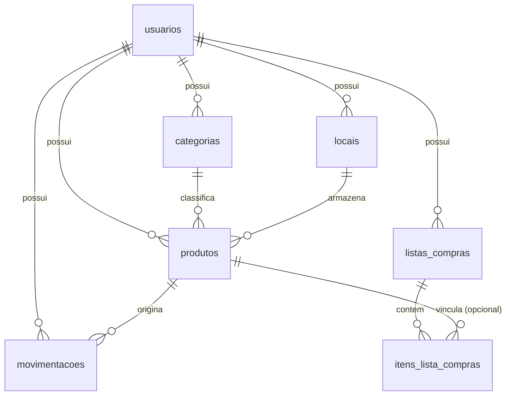

# Freshy — Seu estoque doméstico, mais inteligente 🍃

**Documento:** Especificação Técnica e de Requisitos do Sistema (`spec.md`)  
**Versão:** 1.0 (Atualizada após implementação completa do sistema)  
**Data da Revisão:** Novembro de 2026  
**Autora:** Sofia F. (`sofietefins-design`)  
**Status:** Implementado, validado e funcional  
**Escopo:** Aplicação web para controle de estoque doméstico, combate ao desperdício e planejamento de compras  
**Repositório GitHub:** [https://github.com/sofietefins-design/freshy](https://github.com/sofietefins-design/freshy)  

---

## 1. Identificação e Apresentação do Projeto

O **Freshy** é um sistema web funcional de controle de estoque doméstico desenvolvido para permitir que indivíduos e famílias organizem com precisão os itens mantidos em suas residências, monitorem quantidades físicas e datas de validade, identifiquem previamente produtos em risco de vencimento ou com estoque em nível crítico, registrem baixas reais de consumo e descartes por desperdício e mantenham uma lista de compras inteligente integrada à reposição do lar.

Trata-se de um projeto acadêmico de software estruturado com foco em funcionamento real, banco de dados relacional com integridade estrita, backend seguro em PHP 8.2, arquitetura limpa sem dependência de frameworks corporativos desnecessários, histórico de desenvolvimento verificável e interface visual responsiva e amigável.

---

## 2. Problema que o Sistema Soluciona

No cotidiano doméstico, a gestão de mantimentos enfrenta problemas recorrentes:
1. **Desperdício de alimentos:** itens perecíveis são esquecidos no fundo de despensas e geladeiras, ultrapassando a validade antes que sejam consumidos;
2. **Compras duplicadas ou desnecessárias:** ao fazer compras no supermercado, a falta de visibilidade do estoque real em casa gera aquisições desnecessárias ou a omissão de itens essenciais;
3. **Ausência de dados sobre hábitos de consumo:** famílias raramente mensuram quanto e por que descartam mantimentos (ex.: validade vencida, deterioração, excesso de preparo), inviabilizando mudanças de comportamento econômico e sustentável;
4. **Falta de integração entre estoque e lista de compras:** a lista de reposição é frequentemente feita de forma manual em papéis ou mensagens de texto, sem conexão direta com o que de fato acabou em casa.

O Freshy soluciona esses gargalos oferecendo uma central única, digital e acessível em computadores, tablets e smartphones.

---

## 3. Objetivos do Sistema

### 3.1. Objetivo Geral
Desenvolver e disponibilizar um sistema web intuitivo, seguro e funcional para controle de estoque doméstico, acompanhamento rigoroso de prazos de validade, registro auditável de consumo e desperdício e automação da lista de compras da residência.

### 3.2. Objetivos Específicos
- Permitir o cadastro detalhado de produtos vinculados a categorias de mantimentos e locais físicos de armazenamento;
- Implementar regras de negócio centralizadas para classificação automática de situação de estoque baixo e faixas de validade (vencido, crítico, atenção e normal);
- Proporcionar o registro atômico de consumo e descarte com proteção absoluta contra saldo de estoque negativo;
- Facilitar a reposição de suprimentos por meio de uma lista de compras dinâmica com recurso de importação em lote de produtos em nível baixo;
- Apresentar um painel de controle (Dashboard) alimentado exclusivamente por métricas reais calculadas a partir do banco de dados MySQL;
- Assegurar isolamento rigoroso entre diferentes contas (multi-tenant no nível da aplicação) e conformidade com padrões de segurança modernos (BCRYPT, CSRF, XSS e prepared statements).

---

## 4. Usuários e Público-Alvo

O público-alvo é composto por pessoas responsáveis pelas compras e organização de mantimentos em suas residências, repúblicas estudantis ou pequenas famílias.

### Perfis de Acesso:
- **Visitante Não Autenticado:** pode visualizar a página inicial de apresentação (`index.php`), consultar a tela de login (`login.php`) e realizar seu cadastro (`cadastro.php`). É estritamente impedido de acessar qualquer dado ou rota privada do sistema.
- **Usuário Autenticado:** possui acesso completo a todos os módulos do sistema, podendo manipular única e exclusivamente os registros associados ao seu próprio identificador (`usuario_id`).

> [!NOTE]
> Na versão 1.0, o sistema adota arquitetura de contas individuais isoladas, sem compartilhamento cruzado de estoque entre usuários e sem perfil de superadministrador, priorizando a privacidade e a segurança estrita dos dados residenciais.

---

## 5. Escopo do Projeto

### 5.1. Funcionalidades Incluídas no Escopo (Versão 1.0)
- **Autenticação e Sessões:** cadastro de usuários, login, logout, senhas criptografadas via BCRYPT, regeneração de ID de sessão e proteção contra CSRF em todas as submissões;
- **Categorias e Locais:** gerenciamento (CRUD) de categorias e locais de armazenamento com verificação de integridade referencial;
- **MyStock:** catálogo central de produtos com busca textual por nome, filtros combinados por categoria, local e situação, com controle de unidade e estoque mínimo;
- **Regras de Negócio de Estoque e Validade:** rotinas centralizadas para classificação de estoque baixo e estágios de validade;
- **Módulo de Consumo:** registro de consumo com baixa atômica no estoque e auditoria;
- **Módulo de Desperdício:** registro de descarte com motivo obrigatório, baixa atômica e auditoria;
- **Lista de Compras Inteligente:** inclusão de itens manuais, vinculação a produtos do estoque, marcação de status comprado e importação automática de itens com estoque baixo com 1 clique;
- **Dashboard Analítico:** exibição de indicadores reais e alertas prioritários;
- **Histórico de Movimentações:** rastreamento auditável de entradas, consumos e descartes;
- **Suíte de Testes Automatizada:** script CLI com 24 testes de integração e validação de regras de segurança.

### 5.2. Limitações e Fora do Escopo (Funcionalidades Rejeitadas ou Futuras)
Conforme deliberado no planejamento acadêmico, os seguintes recursos **não fazem parte do escopo atual** para assegurar a viabilidade técnica e a excelência funcional do núcleo da aplicação:
- Leitura de código de barras por câmera do celular;
- Integração por web scraping com supermercados ou cotação de preços em tempo real;
- Inteligência artificial para previsão de consumo ou sugestão de cardápios;
- Envio de notificações push ou mensagens automáticas por WhatsApp / Telegram / e-mail;
- Integração com assistentes virtuais (Alexa, Google Assistant);
- Aplicativo móvel nativo (iOS / Android), sendo o sistema responsivo via navegador;
- Gestão comercial, controle financeiro de custos e fluxo de caixa de comércios.

---

## 6. Casos de Uso do Sistema

| ID | Caso de Uso | Ator Principal | Descrição Sucinta |
|---|---|---|---|
| **UC01** | Criar Conta | Visitante | Informa nome, e-mail único e senha; o sistema cria a conta e inicializa categorias e locais padrão. |
| **UC02** | Autenticar no Sistema (Login) | Visitante | Informa e-mail e senha cadastrados; o sistema valida o hash, regenera a sessão e redireciona ao Dashboard. |
| **UC03** | Encerrar Sessão (Logout) | Usuário | Usuário solicita encerramento; o sistema destrói a sessão, invalida cookies e redireciona ao login. |
| **UC04** | Gerenciar Categorias | Usuário | Cadastra, edita e exclui categorias próprias, impedindo exclusão daquelas vinculadas a produtos ativos. |
| **UC05** | Gerenciar Locais de Armazenamento | Usuário | Cadastra, edita e exclui locais (geladeira, despensa, etc.) com bloqueio de exclusão em caso de vínculos. |
| **UC06** | Cadastrar Produto no MyStock | Usuário | Informa nome, categoria, local, quantidade, unidade, estoque mínimo e validade; o sistema salva e grava movimentação de entrada. |
| **UC07** | Consultar e Filtrar Estoque | Usuário | Lista seus produtos com ordenação por proximidade de validade, aplicando filtros por busca, categoria, local e situação. |
| **UC08** | Editar Dados de Produto | Usuário | Altera informações cadastrais de um produto de sua propriedade. |
| **UC09** | Excluir Produto do Estoque | Usuário | Remove um produto próprio após confirmação explícita. |
| **UC10** | Registrar Consumo | Usuário | Informa quantidade consumida; o sistema valida a disponibilidade, reduz o saldo via transação atômica e audita. |
| **UC11** | Registrar Desperdício | Usuário | Informa quantidade descartada e motivo obrigatório; o sistema reduz o saldo via transação e audita. |
| **UC12** | Gerenciar Lista de Compras | Usuário | Adiciona itens manuais, altera quantidades, marca/desmarca como comprado e remove itens concluídos. |
| **UC13** | Importar Estoque Baixo para Compras | Usuário | Aciona o botão de importação inteligente; o sistema detecta itens com quantidade &le; mínima e os adiciona à lista. |
| **UC14** | Visualizar Dashboard | Usuário | Acessa indicadores reais de produtos cadastrados, itens em falta, alertas de vencimento e movimentações recentes. |
| **UC15** | Consultar Histórico de Movimentações | Usuário | Consulta a trilha de auditoria completa de entradas, consumos e descartes filtrando por tipo e por produto. |

---

## 7. Requisitos Funcionais (RF)

- **RF01 — Cadastro de Usuário:** O sistema deve permitir que novos usuários se cadastrem fornecendo nome (mínimo 3 caracteres), e-mail válido e senha (mínimo 6 caracteres), impedindo o cadastro de e-mails duplicados.
- **RF02 — Inicialização Automática de Dados do Usuário:** Ao registrar um novo usuário, o sistema deve criar automaticamente um conjunto inicial de categorias padrão, locais de armazenamento padrão e uma lista de compras ativa vinculada à conta.
- **RF03 — Autenticação de Usuário (Login):** O sistema deve autenticar o usuário conferindo seu e-mail e senha utilizando verificação criptográfica de hash, exibindo mensagem amigável em caso de credenciais inválidas.
- **RF04 — Encerramento Seguro de Sessão (Logout):** O sistema deve permitir encerrar a sessão a qualquer momento, limpando os dados da sessão no servidor e expirando os cookies no navegador.
- **RF05 — Proteção de Acesso a Páginas Privadas:** O sistema deve barrar requisições não autenticadas a qualquer página interna, redirecionando o visitante para a tela de login com código HTTP 302.
- **RF06 — Gerenciamento de Categorias:** O usuário deve poder cadastrar, listar, renomear e excluir categorias próprias. A exclusão deve ser terminantemente bloqueada caso existam produtos vinculados à categoria.
- **RF07 — Gerenciamento de Locais de Armazenamento:** O usuário deve poder cadastrar, listar, renomear e excluir locais de armazenamento próprios. A exclusão deve ser bloqueada se houver produtos no local.
- **RF08 — Cadastro de Produtos (MyStock):** O sistema deve permitir o cadastro de produtos com nome, categoria do usuário, local de armazenamento do usuário, quantidade atual (&ge; 0), unidade de medida, quantidade mínima de segurança (&ge; 0) e data de validade opcional.
- **RF09 — Registro Automático de Entrada Inicial:** Ao cadastrar um produto com quantidade superior a zero, o sistema deve registrar automaticamente uma movimentação do tipo `ENTRADA` no histórico de auditoria.
- **RF10 — Consulta, Busca e Filtros de Estoque:** O sistema deve listar apenas os produtos pertencentes ao usuário autenticado, ordenados por proximidade de vencimento, com suporte a busca textual por nome e filtros combinados por categoria, local e situação.
- **RF11 — Edição e Exclusão de Produtos:** O usuário deve poder alterar os dados de seus produtos e excluí-los mediante confirmação, garantindo que usuários terceiros não possam alterar registros de outras contas.
- **RF12 — Identificação de Estoque Baixo:** O sistema deve identificar e destacar visualmente produtos em situação de estoque baixo sempre que `quantidade <= quantidade_minima`.
- **RF13 — Identificação de Situação de Validade:** O sistema deve classificar os produtos perecíveis em 4 categorias de validade:
  - *Vencido:* data de validade anterior à data atual;
  - *Crítico:* vencimento entre 0 e 3 dias corridos;
  - *Atenção:* vencimento entre 4 e 7 dias corridos;
  - *Normal:* vencimento superior a 7 dias corridos.
- **RF14 — Registro de Consumo Atômico:** O sistema deve permitir registrar o consumo de produtos com validação de quantidade positiva (&gt; 0), abatendo o saldo de forma atômica no banco de dados e gerando movimentação de `CONSUMO`.
- **RF15 — Prevenção de Saldo Negativo:** O sistema deve rejeitar no servidor qualquer tentativa de consumo ou descarte cuja quantidade solicitada seja superior ao estoque disponível, emitindo mensagem de erro clara.
- **RF16 — Registro de Desperdício com Justificativa:** O sistema deve permitir registrar descarte de produtos com quantidade positiva e obrigatoriedade de seleção do motivo do desperdício, gerando movimentação de `DESPERDICIO`.
- **RF17 — Lista de Compras Inteligente:** O sistema deve permitir manter uma lista de compras com itens manuais e itens vinculados ao estoque, permitindo alterar quantidades, alternar estado de comprado e remover itens.
- **RF18 — Importação em Lote de Estoque Baixo:** A lista de compras deve dispor de ação rápida que detecta todos os produtos do usuário em nível baixo e os insere automaticamente na lista com as quantidades necessárias para restabelecer o estoque mínimo.
- **RF19 — Dashboard com Indicadores Reais:** O sistema deve exibir painel de controle com contadores dinâmicos calculados via SQL (total de produtos, estoque baixo, críticos, vencidos, compras pendentes e 6 últimas movimentações).
- **RF20 — Histórico e Auditoria de Movimentações:** O sistema deve apresentar tela de consulta a todas as movimentações do usuário, com tipo, produto, categoria, quantidade, motivo e data/hora formatada.
- **RF21 — Isolamento Multi-tenant Estrito:** Todas as operações de leitura, gravação, alteração e exclusão devem validar no servidor que os registros pertencem exclusivamente ao `usuario_id` da sessão ativa.

---

## 8. Requisitos Não Funcionais (RNF)

- **RNF01 — Criptografia de Senhas:** Nenhuma senha pode ser armazenada em texto puro. O sistema deve utilizar a API nativa do PHP com `password_hash($senha, PASSWORD_BCRYPT)` e validação por `password_verify()`.
- **RNF02 — Acesso Seguro a Dados via PDO:** Todas as consultas com parâmetros fornecidos pelo usuário devem utilizar PDO com prepared statements nativos e `PDO::ATTR_EMULATE_PREPARES => false`.
- **RNF03 — Prevenção de Injeção SQL:** Toda interação com o banco de dados deve utilizar bindings tipados (`:param`), eliminando o risco de concatenação de strings em comandos SQL.
- **RNF04 — Proteção contra Cross-Site Scripting (XSS):** Todas as saídas de texto renderizadas na interface HTML devem ser tratadas com a função central de escape `htmlspecialchars($valor, ENT_QUOTES, 'UTF-8')`.
- **RNF05 — Proteção contra CSRF (Cross-Site Request Forgery):** Todas as requisições HTTP do tipo POST devem exigir e validar no servidor um token criptográfico pseudoaleatório gerado com `bin2hex(random_bytes(32))` e comparado em tempo constante com `hash_equals()`.
- **RNF06 — Segurança e Regeneração de Sessões:** O cookie de sessão deve ser configurado com flags de segurança (`httponly = true`, `samesite = 'Lax'`). Imediatamente após a validação do login, o identificador da sessão deve ser renovado com `session_regenerate_id(true)`.
- **RNF07 — Isolamento de Credenciais em Variáveis de Ambiente:** Credenciais de banco de dados e segredos da aplicação devem ser configurados exclusivamente no arquivo local `.env`, o qual é estritamente ignorado pelo versionador no `.gitignore`. Um arquivo `.env.example` deve orientar novas instalações.
- **RNF08 — Tratamento de Erros e Mensagens Sensíveis:** Em ambiente de produção (`APP_DEBUG=false`), erros de banco ou exceções do sistema não devem expor consultas SQL, senhas ou caminhos físicos do servidor ao usuário, sendo registrados em logs do servidor.
- **RNF09 — Transacionalidade e Concorrência:** Baixas de estoque por consumo ou desperdício devem ser executadas com bloqueio de concorrência (`SELECT ... FOR UPDATE`) dentro de transações atômicas (`beginTransaction()`, `commit()`, `rollBack()`).
- **RNF10 — Responsividade e Usabilidade (Mobile-First):** As telas devem ser totalmente adaptáveis a diferentes resoluções (smartphones, tablets e computadores), utilizando a biblioteca Bootstrap 5.3 com componentes consistentes e tipografia legível.
- **RNF11 — Padrões de Código e Manutenibilidade:** O código-fonte deve ser organizado com separação de responsabilidades (Models, Helpers, Views e Config), utilizando tipos declarativos do PHP 8.2 (`declare(strict_types=1)`).
- **RNF12 — Desempenho e Indexação:** As tabelas do banco de dados MySQL devem conter índices específicos nos campos de chave estrangeira, e-mail de usuários e datas de validade para garantir respostas sub-segundo em buscas e filtros.
- **RNF13 — Compatibilidade de Plataforma:** O sistema deve executar de maneira consistente em servidores web tradicionais com PHP 8.2 ou superior e MySQL 8.0 / MariaDB 10.4+, compatível com o ambiente XAMPP para Windows.

---

## 9. Regras de Negócio Centrais

### RN01 — Cálculo de Estoque Baixo
Um produto é considerado em **Estoque Baixo** quando:
$$\text{quantidade} \le \text{quantidade\_mínima}$$
Essa condição ativa o badge de alerta amarelo nas telas de estoque e dashboard e habilita a importação do item para a lista de compras.

### RN02 — Classificação de Prazos de Validade
A regra de validade é centralizada na função `calcular_status_validade()` e se baseia na diferença inteira em dias entre a data atual ($\text{hoje}$) e a data de validade ($\text{validade}$):
- **Vencido:** $\text{dias} < 0$ (destaque em vermelho com ícone de alerta);
- **Crítico:** $0 \le \text{dias} \le 3$ (destaque em laranja com recomendação de consumo imediato);
- **Atenção:** $4 \le \text{dias} \le 7$ (destaque em amarelo com alerta de proximidade);
- **Normal:** $\text{dias} > 7$ (destaque em verde indicando prazo regular);
- **Sem Validade:** produtos não perecíveis ou sem data informada (destaque neutro).

### RN03 — Transação Atômica de Consumo e Prevenção de Saldo Negativo
O consumo só é aprovado se:
$$0 < \text{quantidade\_consumo} \le \text{quantidade\_atual}$$
A baixa na tabela `produtos` e a gravação do registro em `movimentacoes` (tipo `CONSUMO`) devem ocorrer na mesma transação atômica. O saldo nunca pode assumir valor negativo.

### RN04 — Descarte de Desperdício com Motivo Obrigatório
O descarte por desperdício abate o saldo físico mediante validação da quantidade disponível e exige obrigatoriamente a seleção de um motivo (ex.: *Prazo de validade vencido*, *Estragado / mofo*, *Embalagem danificada*, *Preparo excessivo*), gerando movimentação do tipo `DESPERDICIO`.

### RN05 — Integridade Referencial em Categorias e Locais
Uma categoria ou local de armazenamento só pode ser excluído se **não possuir nenhum produto vinculado** a ele. Caso existam produtos associados, a exclusão é rejeitada pelo sistema, exigindo que o usuário reatribua ou exclua os produtos antes de remover o agrupador.

### RN06 — Reposição Automática de Compras
Ao disparar a ação de importação de estoque baixo, o sistema calcula a necessidade de compra como:
$$\text{quantidade\_comprar} = \max(1.0, \text{quantidade\_mínima} - \text{quantidade\_atual})$$
e insere os itens pendentes na lista de compras caso ainda não estejam listados.

---

## 10. Modelo de Dados e Relacionamentos

O banco de dados relacional foi implementado no MySQL 8.0 (`freshy_db`), estruturado com o mecanismo InnoDB para suporte completo a chaves estrangeiras, restrições e transações ACID.



### 10.1. Dicionário de Dados das Tabelas

#### 1. `usuarios`
Armazena as contas cadastradas no sistema.
- `id`: INT UNSIGNED AUTO_INCREMENT, Chave Primária;
- `nome`: VARCHAR(150), NOT NULL;
- `email`: VARCHAR(191), NOT NULL, Índice Único (`UNIQUE`);
- `senha_hash`: VARCHAR(255), NOT NULL (armazena o hash BCRYPT);
- `created_at`: TIMESTAMP, NOT NULL, DEFAULT CURRENT_TIMESTAMP.

#### 2. `categorias`
Classificação dos mantimentos definida por usuário.
- `id`: INT UNSIGNED AUTO_INCREMENT, Chave Primária;
- `usuario_id`: INT UNSIGNED, NOT NULL, FK &rarr; `usuarios(id)` ON DELETE CASCADE;
- `nome`: VARCHAR(100), NOT NULL;
- `created_at`: TIMESTAMP, NOT NULL, DEFAULT CURRENT_TIMESTAMP;
- **Constraint:** `UNIQUE KEY (usuario_id, nome)` (impede categorias duplicadas para o mesmo usuário).

#### 3. `locais`
Locais físicos de guarda dos alimentos (geladeira, freezer, despensa, etc.).
- `id`: INT UNSIGNED AUTO_INCREMENT, Chave Primária;
- `usuario_id`: INT UNSIGNED, NOT NULL, FK &rarr; `usuarios(id)` ON DELETE CASCADE;
- `nome`: VARCHAR(100), NOT NULL;
- `created_at`: TIMESTAMP, NOT NULL, DEFAULT CURRENT_TIMESTAMP;
- **Constraint:** `UNIQUE KEY (usuario_id, nome)` (impede locais duplicados para o mesmo usuário).

#### 4. `produtos`
Catálogo central de itens em estoque (MyStock).
- `id`: INT UNSIGNED AUTO_INCREMENT, Chave Primária;
- `usuario_id`: INT UNSIGNED, NOT NULL, FK &rarr; `usuarios(id)` ON DELETE CASCADE;
- `categoria_id`: INT UNSIGNED, NOT NULL, FK &rarr; `categorias(id)` ON DELETE RESTRICT;
- `local_id`: INT UNSIGNED, NOT NULL, FK &rarr; `locais(id)` ON DELETE RESTRICT;
- `nome`: VARCHAR(150), NOT NULL;
- `quantidade`: DECIMAL(10,2), NOT NULL, DEFAULT 0.00;
- `unidade`: VARCHAR(20), NOT NULL, DEFAULT 'un';
- `quantidade_minima`: DECIMAL(10,2), NOT NULL, DEFAULT 1.00;
- `data_validade`: DATE, NULL;
- `created_at`: TIMESTAMP, NOT NULL, DEFAULT CURRENT_TIMESTAMP;
- `updated_at`: TIMESTAMP, NOT NULL, DEFAULT CURRENT_TIMESTAMP ON UPDATE CURRENT_TIMESTAMP;
- **Índices:** `idx_produtos_usuario`, `idx_produtos_validade`, `idx_produtos_categoria`, `idx_produtos_local`.

#### 5. `movimentacoes`
Auditoria de entradas, consumos e descartes de mantimentos.
- `id`: INT UNSIGNED AUTO_INCREMENT, Chave Primária;
- `usuario_id`: INT UNSIGNED, NOT NULL, FK &rarr; `usuarios(id)` ON DELETE CASCADE;
- `produto_id`: INT UNSIGNED, NOT NULL, FK &rarr; `produtos(id)` ON DELETE CASCADE;
- `tipo`: ENUM('ENTRADA', 'CONSUMO', 'DESPERDICIO'), NOT NULL;
- `quantidade`: DECIMAL(10,2), NOT NULL;
- `motivo`: VARCHAR(255), NULL;
- `created_at`: TIMESTAMP, NOT NULL, DEFAULT CURRENT_TIMESTAMP;
- **Índices:** `idx_movimentacoes_usuario`, `idx_movimentacoes_produto`, `idx_movimentacoes_tipo`, `idx_movimentacoes_data`.

#### 6. `listas_compras`
Lista de compras associada a cada usuário.
- `id`: INT UNSIGNED AUTO_INCREMENT, Chave Primária;
- `usuario_id`: INT UNSIGNED, NOT NULL, FK &rarr; `usuarios(id)` ON DELETE CASCADE;
- `created_at`: TIMESTAMP, NOT NULL, DEFAULT CURRENT_TIMESTAMP;
- `updated_at`: TIMESTAMP, NOT NULL, DEFAULT CURRENT_TIMESTAMP ON UPDATE CURRENT_TIMESTAMP.

#### 7. `itens_lista_compras`
Itens inseridos na lista de reposição (manuais ou vinculados a produtos).
- `id`: INT UNSIGNED AUTO_INCREMENT, Chave Primária;
- `lista_id`: INT UNSIGNED, NOT NULL, FK &rarr; `listas_compras(id)` ON DELETE CASCADE;
- `produto_id`: INT UNSIGNED, NULL, FK &rarr; `produtos(id)` ON DELETE SET NULL;
- `nome_item`: VARCHAR(150), NOT NULL;
- `quantidade`: DECIMAL(10,2), NOT NULL, DEFAULT 1.00;
- `comprado`: TINYINT(1), NOT NULL, DEFAULT 0;
- `created_at`: TIMESTAMP, NOT NULL, DEFAULT CURRENT_TIMESTAMP.

---

## 11. Arquitetura e Tecnologias Utilizadas

```text
freshy/
├── public/                     # Raiz pública do servidor web
│   ├── index.php               # Landing page pública de apresentação
│   ├── login.php               # Interface e processamento de login seguro
│   ├── cadastro.php            # Cadastro de novos usuários
│   ├── logout.php              # Destruição segura de sessão
│   ├── dashboard.php           # Painel de controle com métricas reais
│   ├── estoque.php             # Módulo central MyStock com CRUD e filtros
│   ├── categorias.php          # Gerenciamento de categorias e locais
│   ├── compras.php             # Lista de compras com reposição inteligente
│   ├── consumo.php             # Processamento de baixa atômica de consumo
│   ├── desperdicio.php         # Processamento de baixa atômica de desperdício
│   ├── historico.php           # Trilha de auditoria das movimentações
│   └── assets/                 # Folhas de estilo, scripts e imagens
│       ├── css/style.css
│       └── js/app.js
│
├── app/                        # Camada de aplicação fora da raiz pública
│   ├── config/
│   │   ├── config.php          # Inicializador global, carregador .env e sessão
│   │   └── database.php        # Gerenciador de conexão PDO Singleton
│   ├── models/                 # Modelos com queries preparadas e integridade
│   │   ├── Usuario.php
│   │   ├── Categoria.php
│   │   ├── Local.php
│   │   ├── Produto.php
│   │   ├── Movimentacao.php
│   │   └── ListaCompras.php
│   ├── helpers/
│   │   └── functions.php       # Regras de validade, estoque, CSRF e XSS
│   └── views/
│       └── partials/           # Componentes compartilhados (header, navbar, footer, alerts)
│
├── database/                   # Migrações versionadas e dados de teste
│   ├── schema.sql              # DDL com tabelas, índices e foreign keys
│   ├── seed.sql                # DML com dados demonstrativos acadêmicos
│   └── migrate.php             # Script de execução rápida de migração CLI
│
├── tests/
│   └── test_freshy.php         # Suíte automatizada com 24 testes de integração
│
├── .env                        # Variáveis locais (ignorado no Git)
├── .env.example                # Modelo de configuração sem dados sensíveis
├── .gitignore                  # Regras de bloqueio de arquivos confidenciais
├── README.md                   # Manual completo de execução e instalação
├── spec.md                     # Este documento de especificação técnica v1.0
└── CHANGELOG.md                # Histórico de versões no padrão Keep a Changelog
```

### Tecnologias:
- **Backend:** PHP 8.2.12 (tipagem estrita, PDO nativo);
- **Banco de Dados:** MySQL 8.0.44 Community Server (mecanismo InnoDB com integridade referencial);
- **Frontend:** HTML5 semântico, CSS3 personalizado, Bootstrap 5.3.3, Bootstrap Icons 1.11.3 e JavaScript Vanilla;
- **Servidor Web:** Apache 2.4 (módulo XAMPP no Windows);
- **Ferramental de Teste:** PHP CLI com assertions nativas;
- **Versionamento:** Git e GitHub.

---

## 12. Critérios de Aceite (Formato Obrigatório)

Todos os critérios de aceite foram reescritos no formato obrigatório **"Dado que..., Quando..., Então..."** e refletem o comportamento rigorosamente testado e aprovado no sistema real.

### CA01 — Cadastro de Usuário Válido
**Dado que** um visitante não possui conta no Freshy e informa nome com pelo menos 3 caracteres, endereço de e-mail válido ainda não utilizado e senha com no mínimo 6 caracteres com confirmação idêntica,  
**quando** submete o formulário de cadastro com token CSRF válido,  
**então** o sistema deve persistir o novo usuário no banco com senha armazenada exclusivamente via hash BCRYPT, inicializar automaticamente as categorias e locais padrão, criar uma lista de compras vinculada, regenerar a sessão e redirecioná-lo autenticado ao Dashboard com mensagem de boas-vindas.

### CA02 — Cadastro com E-mail Duplicado
**Dado que** um visitante tenta criar uma conta informando um endereço de e-mail que já pertence a outro usuário cadastrado no sistema,  
**quando** envia a requisição de cadastro,  
**então** o sistema deve rejeitar a criação da conta, manter o formulário preenchido com o nome e e-mail informados e exibir alerta informando que o e-mail já está em uso.

### CA03 — Autenticação de Usuário (Login com Credenciais Corretas)
**Dado que** uma conta de usuário já está registrada no banco de dados,  
**quando** o usuário preenche seu e-mail e senha correspondentes e envia o formulário de login com token CSRF válido,  
**então** o sistema deve validar a senha usando `password_verify()`, renovar o identificador da sessão ativa com `session_regenerate_id(true)`, gravar os dados do usuário na sessão sem expor o hash e redirecioná-lo ao Dashboard com mensagem de sucesso.

### CA04 — Tentativa de Login com Senha Incorreta
**Dado que** uma pessoa informa um e-mail existente no sistema porém digita uma senha incorreta,  
**quando** submete o formulário de login,  
**então** o sistema deve negar o acesso, não inicializar sessão e exibir mensagem genérica de erro informando que o e-mail ou a senha estão incorretos, preservando a segurança contra enumeração de contas.

### CA05 — Encerramento de Sessão (Logout)
**Dado que** um usuário está com uma sessão autenticada ativa no sistema,  
**quando** clica na opção de sair ou acessa a rota de logout,  
**então** o sistema deve limpar as variáveis da sessão no servidor, invalidar os cookies de sessão no navegador, destruir a sessão e redirecioná-lo à página de login com aviso de encerramento seguro.

### CA06 — Bloqueio de Acesso a Páginas Protegidas
**Dado que** um visitante não realizou login no sistema,  
**quando** tenta acessar diretamente qualquer URL privada (ex.: `dashboard.php`, `estoque.php`, `compras.php`, `categorias.php`, `historico.php`),  
**então** o sistema deve interceptar a requisição com resposta HTTP 302, bloquear a renderização dos dados e redirecionar o visitante para a página de login com alerta informativo.

### CA07 — Gerenciamento de Categorias de Mantimentos
**Dado que** o usuário está autenticado na página de Categorias e Locais,  
**quando** cadastra uma nova categoria com nome válido e único em sua conta,  
**então** o sistema deve gravar a categoria no banco vinculada ao seu `usuario_id`, exibi-la imediatamente na listagem com o contador de produtos zerado e disponibilizá-la no formulário de cadastro de produtos.

### CA08 — Gerenciamento de Locais de Armazenamento
**Dado que** o usuário está autenticado,  
**quando** cadastra um novo local de armazenamento (ex.: "Despensa Seca", "Freezer Superior"),  
**então** o sistema deve salvar o registro vinculado à sua conta e exibi-lo nos seletores de armazenamento do estoque.

### CA09 — Bloqueio de Exclusão de Categoria ou Local com Produtos Vinculados
**Dado que** uma categoria ou local de armazenamento possui um ou mais produtos do estoque vinculados a ela,  
**quando** o usuário tenta acionar o comando de exclusão dessa categoria ou local,  
**então** o sistema deve impedir a exclusão, desabilitar o botão na interface e, caso receba uma requisição direta, emitir alerta de aviso informando que existem produtos vinculados que impedem a remoção.

### CA10 — Cadastro de Produto no MyStock com Entrada Automática
**Dado que** o usuário autenticado preenche o formulário de novo produto com nome, categoria válida, local válido, quantidade inicial positiva (&gt; 0), unidade de medida, quantidade mínima e data de validade opcional,  
**quando** submete o cadastro com token CSRF válido,  
**então** o sistema deve salvar o produto no MySQL, calcular seu status de estoque e validade, registrar simultaneamente uma movimentação do tipo `ENTRADA` no histórico de auditoria e exibi-lo ordenado na tabela do MyStock.

### CA11 — Consulta, Pesquisa e Filtros no MyStock
**Dado que** o usuário possui produtos cadastrados em diferentes categorias, locais e situações de validade,  
**quando** digita um termo no campo de busca ou seleciona filtros específicos de categoria, local ou situação (ex.: "Estoque Baixo", "Crítico", "Vencido"),  
**então** o sistema deve filtrar dinamicamente a listagem exibindo somente os produtos que satisfaçam cumulativamente os critérios informados.

### CA12 — Edição de Produto Próprio
**Dado que** um produto pertence ao usuário autenticado,  
**quando** o usuário altera seus dados cadastrais (como quantidade atual, unidade ou data de validade) através do modal de edição e salva as alterações,  
**então** o sistema deve atualizar os dados no banco de dados, recalcular imediatamente suas regras de status e apresentar o produto com os novos valores.

### CA13 — Exclusão de Produto com Confirmação
**Dado que** o usuário solicita a remoção de um produto de seu estoque,  
**quando** confirma a exclusão no diálogo de segurança do navegador,  
**então** o sistema deve remover o produto do banco de dados, remover referências vinculadas na lista de compras via `ON DELETE SET NULL` e emitir mensagem de confirmação de exclusão.

### CA14 — Identificação Automática de Estoque Baixo
**Dado que** um produto possui quantidade física menor ou igual à sua quantidade mínima configurada,  
**quando** o estoque ou o dashboard são consultados,  
**então** o sistema deve classificar o item como "Estoque Baixo", aplicando badge visual de alerta âmbar e contabilizando-o nos cards de indicadores.

### CA15 — Classificação das Faixas de Validade
**Dado que** produtos possuem diferentes datas de validade cadastradas,  
**quando** o sistema processa a listagem em qualquer página,  
**então** deve rotular com precisão: produtos com validade anterior a hoje como `Vencido` (vermelho), produtos que vencem em até 3 dias como `Crítico` (laranja), produtos que vencem em 4 a 7 dias como `Atenção` (amarelo) e produtos com prazo superior a 7 dias como `Normal` (verde).

### CA16 — Registro de Consumo Válido com Baixa Atômica
**Dado que** um produto possui estoque disponível suficiente e o usuário informa uma quantidade consumida positiva e menor ou igual ao saldo atual,  
**quando** confirma o formulário de consumo,  
**então** o sistema deve subtrair a quantidade consumida do estoque do produto, persistir uma movimentação de `CONSUMO` com a data atual e a observação informada na mesma transação atômica e atualizar a interface sem recarregar dados inconsistentes.

### CA17 — Bloqueio de Consumo que Resulte em Saldo Negativo
**Dado que** um produto possui determinada quantidade em estoque (ex.: 2 unidades) e o usuário tenta registrar um consumo com quantidade superior à disponível (ex.: 5 unidades),  
**quando** envia a solicitação de consumo,  
**então** o sistema deve interromper a operação com rollback da transação, não alterar o saldo do produto, não gerar registro no histórico e exibir mensagem de erro informando a quantidade disponível e a impossibilidade de saldo negativo.

### CA18 — Registro de Desperdício com Motivo Obrigatório
**Dado que** o usuário identifica um item estragado ou fora de condições de uso em seu estoque e informa uma quantidade compatível com o saldo e seleciona o motivo do descarte,  
**quando** confirma o registro de desperdício,  
**então** o sistema deve reduzir o estoque do produto via transação atômica, registrar uma movimentação do tipo `DESPERDICIO` contendo o motivo obrigatório e registrar o evento para auditoria no histórico.

### CA19 — Adição e Manipulação de Itens na Lista de Compras
**Dado que** o usuário acessa o módulo de Lista de Compras,  
**quando** adiciona um item manual ou seleciona um produto já existente no estoque informando a quantidade desejada,  
**então** o sistema deve salvar o item na lista como não comprado; caso o usuário clique no botão de marcar, o item deve alternar para comprado com formatação tachada; caso solicite exclusão, o item deve ser removido.

### CA20 — Importação em Lote de Produtos com Estoque Baixo para a Lista de Compras
**Dado que** o estoque do usuário possui um ou mais produtos em situação de estoque baixo,  
**quando** o usuário aciona o botão "Importar Estoque Baixo",  
**então** o sistema deve varrer todos os produtos com quantidade &le; mínima e adicioná-los automaticamente à lista de compras calculando a quantidade necessária para atingir o nível mínimo de segurança.

### CA21 — Dashboard Alimentado Exclusivamente por Dados Reais
**Dado que** existem produtos, validades, compras e movimentações gravadas no banco de dados,  
**quando** o usuário autenticado acessa o Dashboard,  
**então** todos os cartões numéricos (total de itens, baixos, críticos, vencidos, compras) e a tabela de movimentações recentes devem refletir exatamente os registros do MySQL, sem a presença de valores fixos ou demonstrativos simulados.

### CA22 — Histórico Completo de Auditoria das Movimentações
**Dado que** ocorreram operações de entrada inicial, consumo diário ou descarte de produtos,  
**quando** o usuário abre a página de Histórico,  
**então** o sistema deve apresentar a lista cronológica decrescente de todas as movimentações de sua residência, permitindo filtrar por tipo de movimentação ou por produto específico.

### CA23 — Isolamento Multi-tenant Rigoroso entre Contas
**Dado que** existem duas contas de usuários distintas no sistema (Usuário A e Usuário B),  
**quando** o Usuário B tenta consultar, editar, excluir ou movimentar um produto, categoria, local ou item de compras pertencente ao Usuário A (seja por interface ou forjando identificadores numéricos na URL/POST),  
**então** o servidor deve validar a cláusula `WHERE usuario_id = :uid`, rejeitar a ação, não permitir leitura nem modificação e assegurar a privacidade total dos dados de cada conta.

### CA24 — Proteção contra Ataques Cross-Site Request Forgery (CSRF)
**Dado que** uma requisição POST é disparada para cadastrar, editar ou excluir qualquer dado no sistema sem o envio do token CSRF ou com um token adulterado/expirado,  
**quando** a requisição atinge o servidor,  
**então** o sistema deve rejeitar o processamento, manter o banco de dados inalterado e apresentar mensagem de erro de validação de segurança.

---

## 13. Histórico de Alterações da Especificação

Esta seção documenta formalmente o comparativo entre a especificação inicial de planejamento (**Versão 0.1**) e a presente especificação consolidada pós-implementação (**Versão 1.0**).

| Categoria | Descrição da Alteração / Evolução | Justificativa Técnica / Acadêmica |
|---|---|---|
| **Requisitos Acrescentados** | **RF18 — Importação em Lote de Estoque Baixo:** inclusão do botão de importação inteligente na lista de compras. | Aumenta a praticidade doméstica, transformando o alerta de estoque baixo em uma ação imediata de reposição. |
| **Requisitos Acrescentados** | **RF02 — Inicialização Automática de Dados do Usuário:** cadastro automático de 9 categorias padrão e 6 locais padrão para novas contas. | Evita a síndrome da "tela vazia", permitindo que o usuário comece a cadastrar produtos imediatamente após criar a conta. |
| **Requisitos Detalhados** | **RF13 / RN02 — Faixas de Validade:** a regra que antes mencionava intervalos genéricos foi estritamente padronizada: Vencido ($< 0$), Crítico ($0 \text{ a } 3\text{ dias}$), Atenção ($4 \text{ a } 7\text{ dias}$) e Normal ($> 7\text{ dias}$). | Garante consistência absoluta entre as telas de MyStock, Dashboard e alertas visuais. |
| **Requisitos Detalhados** | **RF14 / RF16 — Transações Atômicas e Prevenção de Saldo Negativo:** detalhamento explícito de locks de concorrência (`FOR UPDATE`) e transações ACID (`beginTransaction`/`commit`). | Impede inconsistência contábil entre a quantidade no estoque e a trilha de auditoria de movimentações. |
| **Critérios de Aceite** | **Formato Obrigatório:** todos os critérios de aceite foram reescritos no formato estrito **"Dado que..., Quando..., Então..."** e ampliados de 15 para 24 cenários de teste verificáveis. | Atendimento integral às orientações da avaliação acadêmica e garantia de cobertura de testes reais. |
| **Estrutura de Banco de Dados** | **Índices de Performance e Chaves Únicas Compostas:** adição de índices nas colunas `usuario_id`, `data_validade`, `categoria_id`, `local_id`, e das chaves `uq_categoria_usuario_nome` e `uq_local_usuario_nome`. | Garante que um usuário não crie categorias duplicadas com o mesmo nome e otimiza as consultas agregadas do Dashboard. |
| **Estrutura de Banco de Dados** | **Integridade Referencial Estrita:** definição de `ON DELETE RESTRICT` para categorias e locais em produtos, e `ON DELETE SET NULL` para produtos na lista de compras. | Evita registros órfãos e impede a exclusão acidental de categorias que contenham produtos cadastrados. |
| **Melhorias de Segurança** | **Sessões e Prepared Statements:** inclusão de `ATTR_EMULATE_PREPARES => false`, `session_regenerate_id(true)` no login e cookies `SameSite=Lax` com `HttpOnly`. | Elevação do nível de segurança da aplicação contra SQL Injection nativo, Session Fixation e roubo de cookies por scripts. |
| **Arquitetura de Software** | **Autoload e Camada de Models:** implementação de `spl_autoload_register` em `app/helpers/functions.php` e modularização dos Models (`Usuario`, `Categoria`, `Local`, `Produto`, `Movimentacao`, `ListaCompras`). | Elimina dezenas de `require_once` espalhados e organiza o código no padrão MVC sem dependência de bibliotecas externas. |
| **Funcionalidades Mantidas** | CRUD de produtos com quantidade mínima, registro de consumo, registro de desperdício com motivo, lista de compras e isolamento por usuário. | Permaneceram fiéis à proposta original de controle de estoque doméstico simples e prático. |

---

## 14. Repositório e Acesso

### 14.1. Dados do Repositório
- **Link Oficial:** [https://github.com/sofietefins-design/freshy](https://github.com/sofietefins-design/freshy)
- **Nome do Repositório:** `sofietefins-design/freshy`
- **Branch Principal:** `main`
- **Visibilidade:** O repositório está configurado para acompanhamento do desenvolvimento acadêmico.

### 14.2. Como Acessar o Código-Fonte
O código-fonte completo pode ser inspecionado diretamente no navegador através do link acima ou clonado via terminal Git:
```bash
git clone https://github.com/sofietefins-design/freshy.git
cd freshy
```

### 14.3. Orientações para Compartilhamento de Acesso com o Professor
- **Se o repositório estiver com visibilidade pública:** o professor poderá acessar, clonar e inspecionar todo o código-fonte, branches e histórico de commits diretamente pelo link oficial sem necessidade de solicitação prévia.
- **Se o repositório estiver com visibilidade privada:** o acesso deve ser concedido seguindo este procedimento:
  1. No GitHub, acesse a página do repositório: `https://github.com/sofietefins-design/freshy`;
  2. Clique na aba superior **Settings** (Configurações);
  3. No menu lateral esquerdo, selecione a seção **Collaborators** (Colaboradores);
  4. Clique no botão verde **Add people** (Adicionar pessoas);
  5. No campo de busca, digite o nome de usuário do GitHub ou o endereço de e-mail institucional fornecido pelo professor;
  6. Confirme a inclusão clicando em **Add [usuário] to this repository**;
  7. Um convite oficial de colaboração será enviado ao professor para que ele visualize o projeto.

---

## 15. Instruções de Execução e Testes Locais

### 15.1. Ambiente de Execução Local
- **Caminho do Projeto no Computador:** `C:\xampp\htdocs\sofial\Freshy`
- **URL da Aplicação no Navegador:** [http://localhost/sofial/Freshy/public/](http://localhost/sofial/Freshy/public/)
- **Servidor Web:** Apache 2.4 (ativo no XAMPP Control Panel)
- **Servidor de Banco de Dados:** MySQL 8.0 (serviço ativo na porta 3306)

### 15.2. Acesso Imediato para Avaliação Acadêmica (Seed Demonstrativo)
Para avaliar o sistema com produtos pré-carregados em todas as situações de estoque e validade:
- **URL de Login:** [http://localhost/sofial/Freshy/public/login.php](http://localhost/sofial/Freshy/public/login.php)
- **E-mail:** `demo@freshy.com.br`
- **Senha:** `senha123`

### 15.3. Execução da Suíte de Testes Automatizada
Para verificar a conformidade de todos os Requisitos Funcionais e regras de segurança via terminal:
```bash
php tests/test_freshy.php
```
*Resultado esperado:* 24 testes aprovados com 100% de êxito.
